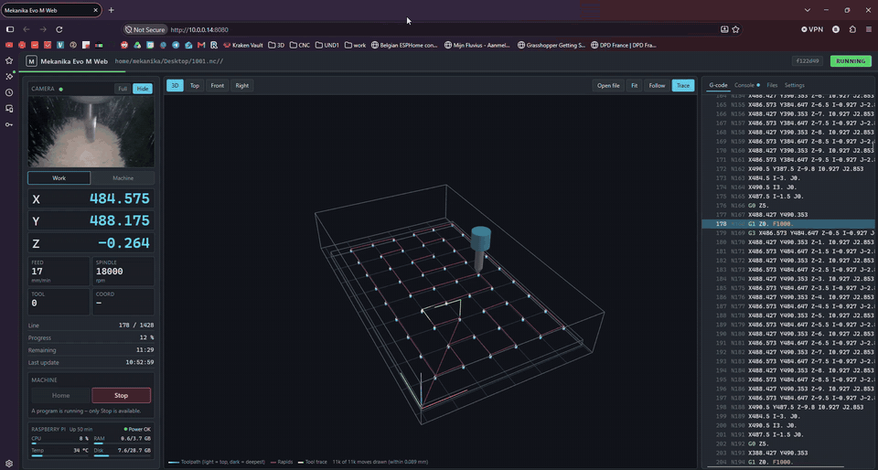
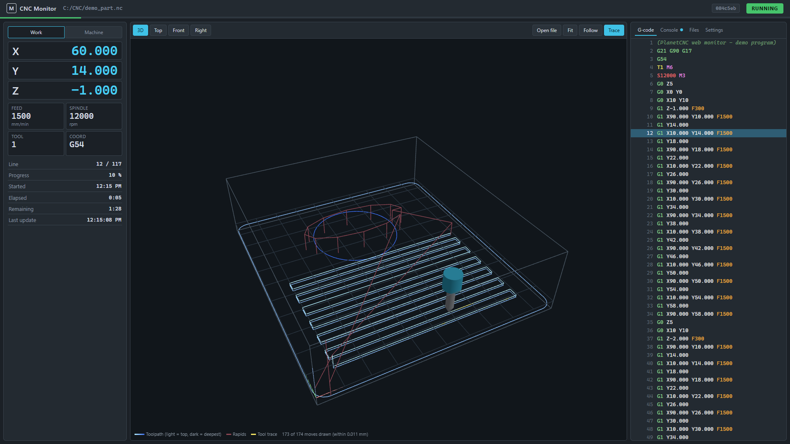
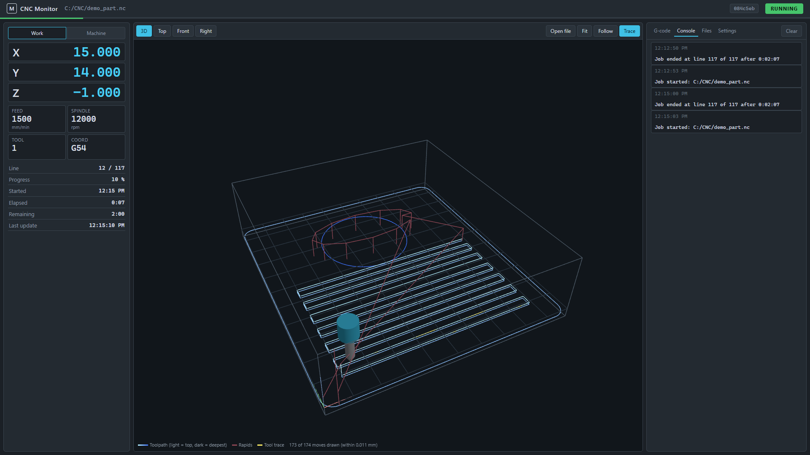
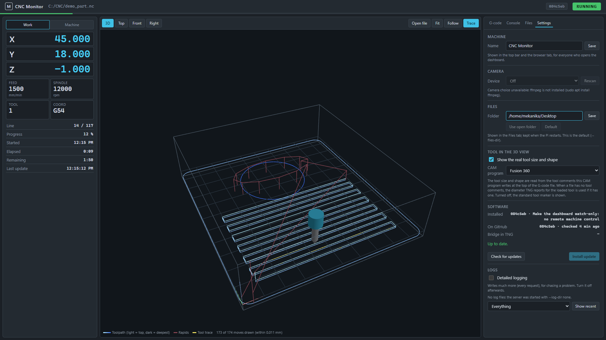
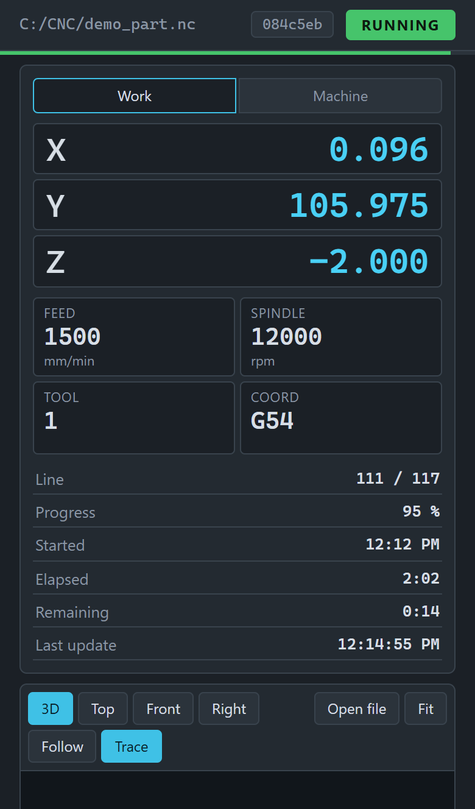
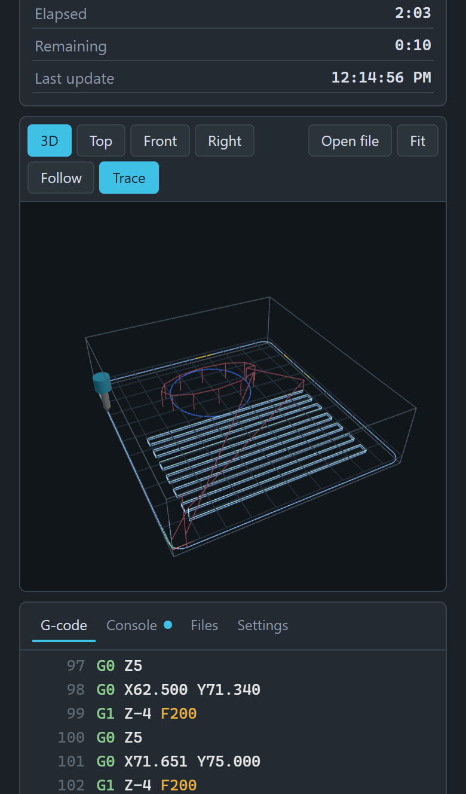
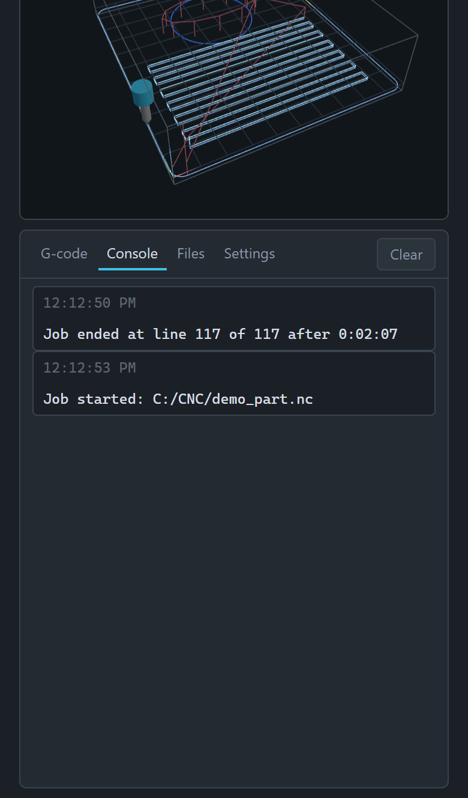
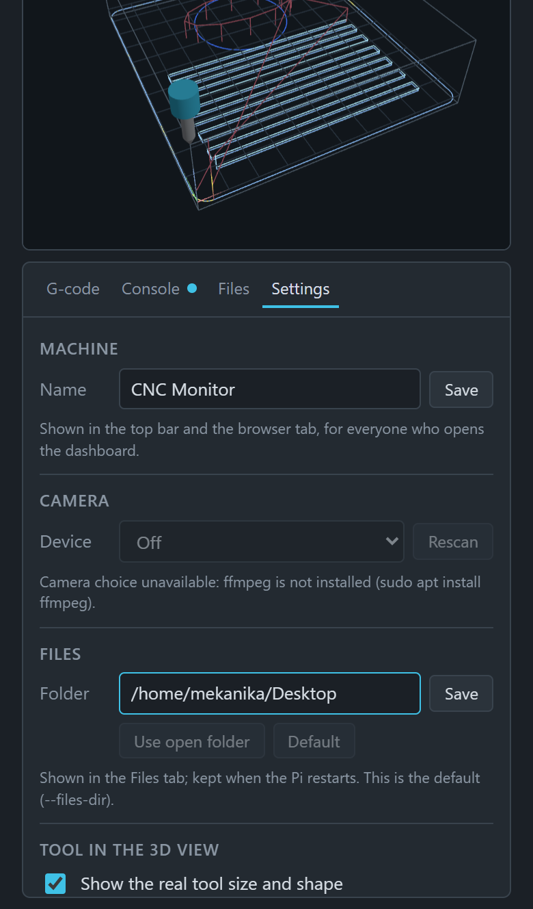

# PlanetCNC Web Monitor

A web dashboard for a CNC machine run by PlanetCNC TNG. Open it from any
computer, tablet or phone on the home network to watch the machine and the job
it is running.



*The dashboard on the real machine during a job: live camera and position on
the left, the 3D toolpath with the tool's trace in the middle, the G-code on
the right.*

## Contents

- [Features](#features)
- [Screenshots](#screenshots)
- [How it works](#how-it-works)
- [What you need](#what-you-need)
- [Installation](#installation)
- [Using the dashboard](#using-the-dashboard)
- [Telegram notifications and timelapse](#telegram-notifications-and-timelapse)
- [Updating](#updating)
- [Logs and debugging](#logs-and-debugging)
- [Server options](#server-options)
- [Inside the bridge](#inside-the-bridge)
- [Troubleshooting](#troubleshooting)
- [Uninstalling](#uninstalling)

## Features

**Watch the machine**

- Live position of every axis (X, Y, Z, plus A, B, C when used), in work or
  machine coordinates, updated 5 times a second.
- Feed rate, spindle speed, tool number and coordinate system.
- Status at a glance: running, paused, E-stop, idle or offline.
- A software **E-stop** button, always in view. It is the only thing the
  dashboard can make the machine do; it only switches E-stop on, and releasing
  it happens at the machine.
- Job progress: current line, percentage, start time, elapsed time and time
  remaining, with a progress bar under the top bar.
- Live picture from a USB camera pointed at the machine (MJPEG through ffmpeg),
  fullscreen with a double-click. The camera also has a page of its own, for a
  second screen or a phone, and a stream and a still-picture address for other
  programs.

**3D view**

- The machine's real travel area as a grid and box, from TNG's motor limits,
  with the work zero marked.
- The job's toolpath, shaded by depth, with rapids in red. Large 3D jobs are
  simplified so they stay smooth, within a stated tolerance.
- The tool at its real diameter and shape (flat, ball, bull nose, V-bit,
  drill), read from Fusion 360 tool comments in the G-code.
- The trace of where the tool has actually been during this job.
- 3D, top, front and right views; fit, follow-the-tool, mouse and touch control.
- Preview any G-code file from your computer against the bed before cutting,
  without touching TNG.

**On your phone, through Telegram**

- Messages from your own Telegram bot when a job starts, every 10, 20, 25 or
  50 %, when it pauses, on E-stop and when it ends (finished, or stopped at
  which line), each with a camera photo. Also when TNG drops out during a job,
  and Pi warnings (under-voltage, heat).
- A **timelapse** of every job from the camera: a short video, sent with the
  "job ended" message and kept on the Pi.
- `/status` and `/photo` in the chat. The bot only reports: it can't control
  the machine.

**Program, console and files**

- The G-code program, with the line being run highlighted and kept in view.
- A console of what happened: jobs started, paused and ended (with how long
  they took), E-stop, tool changes, program changes, updates, the bridge
  connecting or getting lost.
- A Files tab for a folder on the Pi: browse, preview G-code in the 3D view,
  download, upload (also by drag and drop) and delete.

**Feeds and step height**

- A **Feeds & steps** window to change, per operation, the feeds, spindle
  speed, drilling peck depth and step height of a program on the Pi, or leave
  operations out, without going back to the PC. The result is saved as a new file; the original stays.
- A **Feeds** tab that keeps every adjustment, how each job with it went, and
  the values you marked as working, ready to copy into Fusion 360.

**The Raspberry Pi and the app**

- Pi health: CPU, memory, temperature, disk use, uptime, and under-voltage or
  throttling warnings from the Pi's firmware.
- Settings in the page: machine name, camera, Files folder, tool display.
- A **System** window: the Pi's model, OS, kernel and uptime; one-click
  updates of the app from GitHub, with rollback (the bridge inside TNG reloads
  itself, so TNG keeps running); Raspberry Pi OS package upgrades; reboot and
  shut down the Pi.
- A log with automatic cleanup, readable and downloadable from the dashboard.
- Works on phones and tablets; several people can watch at the same time.
- Nothing to install with pip: only Python's standard library on the Pi.

**Left out on purpose**

- **No machine control, apart from the E-stop.** The dashboard can't move,
  home, start, pause or resume the machine, release the E-stop, send G-code, or
  load a program into TNG. For safety, everything that makes the machine do
  something happens at the machine, in TNG. This isn't just hidden in the
  page: the server has no way to send such a command, and the bridge inside
  TNG refuses anything but reading and switching the E-stop on.
- **No password.** Anyone on the home network who opens the page can see it,
  manage the files in the Files tab, press the E-stop and, once you allow it,
  upgrade or reboot the Pi when no job runs. Don't make the dashboard
  reachable from the internet.

## Screenshots

These were taken with the built-in demo (`python3 server.py --demo`), which
simulates a job. The demo has no camera and doesn't run on a Pi, so the camera
and Raspberry Pi panels are missing; on the real machine they sit at the top
and bottom of the left column (see the animation above).

### Desktop



The full layout on a 1920×1080 screen. Left: position, feed, spindle, tool and
the job's progress and times. Middle: the 3D view with the bed, the toolpath
(light blue cuts, red rapids), the yellow trace of where the tool has been and
the tool itself. Right: the G-code, with the line being run highlighted.



The **Console** tab lists what happened with times, here two demo jobs
starting and ending, with how long each took.



The **Settings** tab: machine name, camera, Files folder, how the tool is
drawn, the way to the System window, and logs.

### Phone

<table>
<tr>
<td width="25%"></td>
<td width="25%"></td>
<td width="25%"></td>
<td width="25%"></td>
</tr>
<tr>
<td>Position, feed, spindle and job progress come first.</td>
<td>Scroll down for the 3D view (one finger rotates, two zoom and pan) and the G-code.</td>
<td>The Console tab.</td>
<td>The Settings tab.</td>
</tr>
</table>

On a phone (here 390×844, an iPhone 14) the columns stack: camera, position
and job first, then the 3D view, then the tabbed panel.

To retake these after changing the page, see `tools/screenshots.py` (runs on a
PC with Chrome; not needed on the Pi).

## How it works

```
 ┌──────────── Raspberry Pi ─────────────────────────────┐
 │                                                       │
 │  PlanetCNC TNG                                        │
 │   └─ bridge (planetcnc_bridge.py, runs inside TNG)    │
 │        │  machine state 5x/s, program, log lines      │
 │        ▼  ▲ what to read, and the E-stop (only on)    │
 │  server.py ◄── USB camera (through ffmpeg)            │
 │        │                                              │
 └────────┼──────────────────────────────────────────────┘
          ▼ http://<pi-address>:8080
   browsers on the home network (PC, tablet, phone)
```

There are three parts:

1. **The bridge** (`bridge/planetcnc_bridge.py`) runs inside TNG, because only
   there can Python read TNG's state through the `planetcnc` module. Five
   times a second it reads the values the server asks for and sends them to
   the server. When the loaded program changes, it sends the program to the
   server as well. It only reads, with one exception: when the dashboard's
   E-stop button is pressed, it switches TNG's E-stop on.
2. **The server** (`server.py`) is a small web server written in Python, using
   only the standard library, so there's nothing to `pip install`. It turns the
   bridge's raw values into what the dashboard shows and pushes every change
   to each open dashboard. It also streams the camera, lists the Pi's files,
   runs updates (of itself and of the Pi's OS packages) and writes the log.
3. **The dashboard** (`web/`) is the page the browser loads. It draws the 3D
   view with three.js, which the browser downloads from a CDN, so the device
   viewing it needs internet access. The Pi itself doesn't.

The bridge and the server run on the same Pi and talk over `127.0.0.1`. By
default the server only accepts a bridge from the Pi itself.

### Files

| File | What it is |
|---|---|
| `server.py` | The web server. |
| `bridge/planetcnc_bridge.py` | Runs inside TNG: reads TNG's state and sends it to the server. |
| `bridge/bridge_autostart.py` | Started by TNG at startup; runs the bridge in the background and restarts it after a crash. |
| `bridge/Expr_WebMonitor.txt` | Tells TNG to run `bridge_autostart.py` when it starts. |
| `update.sh` | Gets the latest version from GitHub and copies the bridge files into TNG's profile. |
| `tools/setup-sudo.sh` | Optional: lets the System window upgrade OS packages and reboot the Pi (see [step 7](#7-optional-allow-os-upgrades-and-reboot-from-the-dashboard)). |
| `tools/screenshots.py` | Retakes the README screenshots from the demo (on a PC, not needed on the Pi). |
| `media/` | The animation and screenshots in this README. |
| `web/` | The dashboard page (HTML, CSS, JavaScript). `tune.js` reads and rewrites programs for the Feeds & steps window; `system-ui.js` holds the E-stop button and the System window; `camera.html` is the camera page on its own. |
| `settings.json` | Created when you change a setting in the dashboard; it also holds the Telegram bot token, so only its owner may read it. Not part of git. |
| `timelapses/` | The last 20 job timelapses. Not part of git. |
| `tuning.json` | The Feeds tab's log of adjusted files. Not part of git. |
| `logs/` | The server's log files. Not part of git. |

## What you need

- A Raspberry Pi (or another Linux computer) running **PlanetCNC TNG** with
  the machine connected. This guide uses the setup it was written for:
  - user `mekanika`;
  - app in `/home/mekanika/PlanetCNC_webapp`;
  - TNG profile in `/home/mekanika/PlanetCNC/Profiles/Default`.

  Replace these with your own where they differ. Where this guide writes
  `<pi-address>`, use your Pi's address on your network, for example
  `192.168.1.20`. Step 3 shows how to find it.
- **Python 3.8 or newer.** Raspberry Pi OS already has it.
- **git**, to install and update the app.
- **ffmpeg**, only if you want the camera.
- A **USB camera** (optional). Most webcams work. A camera that sends MJPEG
  costs the Pi almost no CPU.

## Installation

Do all of this on the Pi, at its keyboard or over SSH
(`ssh mekanika@<pi-address>`).

### 1. Install git and ffmpeg

```bash
sudo apt update
sudo apt install git ffmpeg
```

### 2. Get the app

```bash
git clone https://github.com/Benoit-LdL/PlanetCNC_webapp ~/PlanetCNC_webapp
```

Keep it a git clone: the dashboard's update button and `update.sh` rely on it.
Don't edit files in this folder by hand, because changed files block updates.

### 3. Try the server

```bash
cd ~/PlanetCNC_webapp
python3 server.py --demo
```

`--demo` simulates a machine running a job, so you can check the dashboard
before TNG is involved. The server prints the address to open:

```
  Open the dashboard (demo):
    from another device on your network:  http://192.168.1.20:8080
    on this computer:                     http://localhost:8080
  Press Ctrl+C to stop.
```

Open the first address in a browser on another device (your numbers will
differ). That address is your Pi's `<pi-address>`; keep it for later. You
should see the demo part being cut. Press Ctrl+C to stop the server.

The demo also runs on any PC with Python 3.8+, without TNG, if you just want
to look at the dashboard. `hostname -I` on the Pi also shows its address.

### 4. Enable Python in TNG

TNG has to know where Python's shared library is. Find it:

```bash
ls /usr/local/lib/libpython3* /usr/lib/*/libpython3*
```

If nothing is listed, run `sudo apt install libpython3-dev` and look again.

In TNG, open **Settings → Python Library** and enter the full path of the
`libpython3.x.so...` file, e.g. `/usr/local/lib/libpython3.11.so.1.0`. Press
**Check**: it should show the Python version. Then restart TNG.

### 5. Install the bridge into TNG

```bash
~/PlanetCNC_webapp/update.sh
```

This copies three files into TNG's profile:

| Copied to | File |
|---|---|
| `Profiles/Default/Scripts/` | `planetcnc_bridge.py`, `bridge_autostart.py` |
| `Profiles/Default/Expr/` | `Expr_WebMonitor.txt` |

TNG runs the `#OnInit` section of every `Expr*.txt` file in that folder when
it starts. `Expr_WebMonitor.txt` uses it to start the bridge through
`bridge_autostart.py`, in the background so TNG doesn't wait for it. It's a
separate file, so the machine maker's own `Expr.txt` stays untouched.

For another profile, put `PCNC_PROFILE=/path/to/profile` in front of the
command. `Expr_WebMonitor.txt` and `bridge_autostart.py` contain the full
profile path, so adjust it in both files too.

### 6. Start the server at boot

Create the service file:

```bash
sudo nano /etc/systemd/system/planetcnc-web.service
```

with this content (change the user and paths if yours differ):

```ini
[Unit]
Description=PlanetCNC web monitor
After=network-online.target
Wants=network-online.target

[Service]
User=mekanika
EnvironmentFile=-/etc/planetcnc-web.env
WorkingDirectory=/home/mekanika/PlanetCNC_webapp
ExecStart=/usr/bin/python3 /home/mekanika/PlanetCNC_webapp/server.py
Restart=always
RestartSec=3

[Install]
WantedBy=multi-user.target
```

`Restart=always` matters: after an update the server stops itself, and
systemd starts the new version.

Then enable it:

```bash
sudo usermod -aG video mekanika           # let that user read the camera
sudo systemctl daemon-reload
sudo systemctl enable --now planetcnc-web
```

To pass [server options](#server-options), add them to the `ExecStart` line,
then run `sudo systemctl daemon-reload && sudo systemctl restart planetcnc-web`.

### 7. Optional: allow OS upgrades and reboot from the dashboard

The System window shows which Raspberry Pi OS packages can be upgraded. To
also upgrade them, refresh the package lists, and reboot or shut down the Pi
from there, the server needs to run those few commands as root. Allow exactly
those, and nothing else:

```bash
~/PlanetCNC_webapp/tools/setup-sudo.sh
```

It writes `/etc/sudoers.d/planetcnc-web` for the user that runs it (give
another user's name as argument if the server runs as someone else), after
checking the file with `visudo`. It allows `apt-get update`,
`apt-get upgrade` (with fixed options) and `systemctl reboot` / `poweroff`,
without a password. `tools/setup-sudo.sh remove` takes it away again.

If your user already has sudo without a password (some Raspberry Pi OS
installs do), this works without the script.

### 8. Restart TNG and check

Restart TNG (or the whole Pi). Then check each part:

| Check | Expected |
|---|---|
| TNG's output window | `PlanetCNC web bridge: connected to http://127.0.0.1:8080` |
| `systemctl status planetcnc-web` | `active (running)` |
| `journalctl -u planetcnc-web -n 20` | `PlanetCNC web monitor on http://<pi-address>:8080` and `bridge: connected from 127.0.0.1` |
| http://&lt;pi-address&gt;:8080 | Status shows `IDLE` (not `OFFLINE`), the position matches TNG |

If something doesn't match, see [Troubleshooting](#troubleshooting).

Then press the dashboard's **E-stop** once, while the machine is idle: TNG
should go into E-stop. Release it at the machine.

### Starting by hand instead

For testing without the service and the autostart:

```bash
cd ~/PlanetCNC_webapp && python3 server.py
```

and in TNG, **File → Run Python Script** →
`Profiles/Default/Scripts/planetcnc_bridge.py`. The server only runs as long
as its terminal stays open.

## Using the dashboard

Open **http://&lt;pi-address&gt;:8080** (see [step 3](#3-try-the-server)). The page adapts to tablets and phones.

### Top bar

- The machine's name (set in Settings) and the loaded file.
- The **System** button with the installed version. When an update of the
  app or of the OS is available it says so. It opens the
  [System window](#system-window).
- The status:

  | Status | Meaning |
  |---|---|
  | `RUNNING` (green) | A job is running. |
  | `PAUSED` (yellow) | The job is paused. |
  | `E-STOP` (red, blinking) | The emergency stop is active. |
  | `IDLE` | Connected, no job running. |
  | `OFFLINE` | The server gets no updates from the bridge, or this page lost its connection to the server. |

- The red **E-STOP** button, see [E-stop](#e-stop).
- The thin bar below the top bar shows job progress.

### E-stop

The red **E-STOP** button at the right of the top bar (also at the top of the
Feeds & steps and System windows) switches TNG's E-stop on, like the E-stop
command in TNG. TNG stops the machine at once.

- One tap, no confirmation: it is meant for an emergency.
- It only switches E-stop **on**. Pressing it again does nothing. To go on,
  release the E-stop at the machine, in TNG, and start again there.
- It reaches TNG through the bridge, so it takes up to a few tenths of a
  second, and it needs the network, the Pi and TNG to work. **It doesn't
  replace the machine's own emergency stop button**, which cuts the power
  directly.
- It's greyed out while TNG isn't connected ("use the E-stop at the
  machine"), while E-stop is already on (**ENGAGED**), and while the bridge in
  TNG is too old for it (install the update; see the System window).
- If it fails, the page says so in a pop-up: use the machine's E-stop.
- The Console and the log say who pressed it (the device's address and
  browser).

### Left panel

- **Camera** at the top:
  - The green dot means the camera is live; red means no picture.
  - **Full**, or a double-click, shows it fullscreen. **Hide** folds it away;
    each browser remembers this.
  - The Pi only runs the camera while someone has the dashboard open. A
    browser tab in the background doesn't keep it running.
  - The camera can also be opened on its own, without the dashboard: see
    [The camera on its own](#the-camera-on-its-own).
- **Position** of each axis. Switch between **Work** and **Machine**
  coordinates with the tabs. A, B and C only appear when they are used.
- **Feed, spindle, tool, coordinate system.**
- **Line, progress, start time, elapsed time** (since the job started, pauses
  included), **time remaining** (TNG's own estimate when it has one) and the
  time of the last update. The console also says how long a job took when it ends.
- **Raspberry Pi:** CPU, memory, temperature and disk use, refreshed every 2
  seconds, plus uptime.
  - A bar and its value turn amber or red, with a word (busy, high, warm, hot, full), when a
    value gets high. The Pi slows itself down from about 80 °C.
  - Next to the title is the power status from the Pi's firmware:
    **Under-voltage!** means the power supply is too weak right now, and
    "since boot" means it happened earlier. A weak supply is a common cause of
    random Pi problems.

### 3D view (middle)

- **The grid and box** are the machine's real travel, from TNG's motor limits
  (Settings → Motors → Limits), placed relative to your current work zero.
  The red, green and blue arrows mark work zero.
- **The toolpath.** Cutting moves are shaded by depth: light at the top, dark
  blue at the deepest cut. Rapids are dark red. The thin box around the job
  covers every move.
  - Big 3D jobs have millions of tiny moves, too many to draw smoothly. The
    view drops points that lie within a small distance of a straight line
    through their neighbours. The shape stays, but there are far fewer lines.
  - The note under the view says how many moves are drawn and how far the
    drawing can be from the real path, for example "10k of 480k moves drawn
    (within 0.012 mm)".
- **The tool** is drawn at its real diameter and shape (flat, ball, bull nose,
  V-bit or drill) when the size is known and this is turned on in Settings,
  with a small see-through holder above it. Under the tool
  number, the left panel says which size is drawn and where it came from,
  e.g. "Ø6 mm (program)". The size comes from:
  1. the tool comments the CAM program writes at the top of the file, such as
     Fusion's `(T5 D=3. CR=0. - ZMIN=-10.2 - FLAT END MILL)`, for the tool the
     program selects at the current line;
  2. otherwise the diameter TNG reports for the loaded tool, if it has one
     (converted when TNG and the program use different units);
  3. otherwise a generic bit sized to the grid.
- **Trace** (yellow) shows where the tool actually went during this job.
- **3D / Top / Front / Right** switch the angle; **Fit** shows the bed and the
  job; **Follow** keeps the tool centred.
- **Open file** previews a G-code file from your computer, without touching
  TNG, so you can check its origin and orientation against the bed. Only this
  screen shows it. **Close preview** goes back to TNG's program.
- **Mouse:** left-drag rotates (3D only), right-drag pans, the wheel zooms.
  **Touch:** one finger rotates, two fingers zoom and pan.

### G-code, Console, Files and Settings (right)

One panel with a tab for each; it uses the full height of the window.

**G-code.** The line being run is highlighted and kept in view. Scroll to look
around; **Follow line** jumps back to the current line.

**Console.** What happened, with times:

- job started, ended (with how long it took) or paused, E-stop, tool changes,
  program loaded;
- software updates;
- the bridge connecting or getting lost.

A dot on the tab means new lines arrived (red if one is an error). **Clear**
empties this view only. The server keeps the last 500 lines.

**Files.** A folder on the Pi: the Desktop by default, or the one chosen in
Settings. The tab only appears when there is a folder.

- Click a folder to open it, and the path at the top to go back. The list
  refreshes by itself every 15 seconds.
- Per file: the eye previews G-code in the 3D view, the sliders open the
  [Feeds & steps](#feeds--steps) window, the arrow downloads the file, and the
  bin deletes it (after asking).
- **Drag files onto the panel** (on any tab), or press **Upload**, to put them
  in the folder shown. An existing file is only replaced after you confirm.

**Feeds.** Every file saved from the Feeds & steps window (see below), newest
first: what changed in each operation compared to Fusion, and each job run
with it ("ran to the end" or "stopped at line …", with how long it took).

- Mark each one **Worked**, **Still too much** or **Not sure yet**, and add a
  note (sound, chips, finish).
- **Worked – copy these into Fusion** at the top lists, per tool and
  operation, the newest values you marked as working, next to the Fusion
  values they replace.
- When a job with an adjusted file ends, the console reminds you to mark it.
- The log is kept in `tuning.json` next to `server.py` (up to 500 entries).
  Removing an entry leaves the file on the Pi.

**Settings.**

- **Name:** the machine's name, shown in the top bar and the browser tab, for
  everyone.
- **Camera:** **Automatic** (the first camera found), a specific camera, or
  **Off**. The change applies right away.
  - USB cameras are listed by their stable name, so the choice still works
    when the camera is plugged into another port.
  - **Rescan** looks again after you plug a camera in.
- **Files:** the folder shown in the Files tab. Type a path on the Pi and
  press **Save**, or open a folder in the Files tab and press **Use open
  folder**. **Default** goes back to `--files-dir`. If the chosen folder is
  gone when the server starts, it uses `--files-dir`.
- **Tool in the 3D view:** **Show the real tool size and shape** turns the
  real-size tool on or off (off: always the standard marker). **CAM program**
  says whose tool comments to read; only **Fusion 360** for now. The choice
  applies to every open dashboard right away.
- **Telegram** and **Timelapse:** see
  [Telegram notifications and timelapse](#telegram-notifications-and-timelapse).
- **Software and system:** opens the [System window](#system-window).
- **Logs:** see [Logs and debugging](#logs-and-debugging).

Settings are saved in `settings.json` next to `server.py`. Updates keep them.

### System window

Open it with the **System** button in the top bar (or **Settings → Software
and system**).

- **Raspberry Pi:** model, OS, kernel, Python, name and address, how long the
  Pi and the dashboard server have been running.
- **Updates:** **Check for updates** checks GitHub and refreshes the OS
  package lists now; the Pi also does both every 6 hours.
  - **PlanetCNC Web Monitor:** the installed version and what is on GitHub,
    with **Install update** and **Roll back**, see [Updating](#updating).
  - **Bridge in TNG:** the version running inside TNG, and whether the copy in
    TNG's profile is the same as this version of the app.
  - **Raspberry Pi OS packages:** how many packages can be upgraded (**Show**
    lists them, with old and new version) and how old the package lists are.
    **Upgrade packages** runs `apt-get upgrade`; its output appears below, live.
    It can take several minutes. Afterwards, restart TNG or reboot the Pi so
    everything uses the new libraries; the window says when the Pi needs a
    reboot. Packages that need `apt full-upgrade` are listed as held back: do
    those over SSH.
- **Power:** **Reboot Pi** and **Shut down Pi**, after a confirmation. TNG
  closes with the Pi. After a reboot the page reloads itself when the Pi is
  back; after a shutdown, switch the Pi off and on to start it again.

Upgrading packages, rebooting and shutting down are refused while a program
runs, and need [step 7](#7-optional-allow-os-upgrades-and-reboot-from-the-dashboard)
of the installation. Without it the window still shows what can be upgraded,
from the package lists as the Pi last refreshed them.

### Feeds & steps

> **Experimental.** This rewrites G-code and has only been tested on a few
> programs; the window says so too. Before cutting with a new file, check it
> with **Preview**, keep a hand near the E-stop, and run the first moves (or
> the whole job) in the air above the part.

For when a cut turns out too heavy: stop it at the machine, change the values
here (from the Files tab, or **Feeds & steps** above the G-code of the loaded
program), save, and load the new file in TNG at the machine.

The window reads the program into its operations (Fusion writes each
operation's name, e.g. `(2D Adaptive1)`, before it) and shows for each one,
with the tool from Fusion's tool comments:

- **Feeds**, each named by what it's used for: cutting, lead-in/out, ramp,
  plunge, drilling, or retract (Fusion for personal use writes rapids as feed
  moves). **All feeds −20 % … +20 %** changes them together.
- **Include**: untick it to leave the operation out of the new file; it's
  greyed out. Its moves go, but what later operations rely on stays: spindle,
  coolant, work offset, tool length, modes, returns home, and its tool change
  when the next operation uses that tool without changing tools itself.
  Before the next operation's first move the tool goes up to that operation's
  top height (and, if that move is a cut, over to its start and down at the
  plunge feed).
- **Spindle speed** and, for peck drilling (G83, G73), the **peck depth**.
- **Step height**, for operations that cut in flat passes from top to bottom
  (2D pocket, 2D adaptive, contour with multiple depths). It lists the passes
  and the biggest step. A smaller **Max. stepdown** (Fusion's *Maximum
  roughing stepdown* under Multiple depths) adds extra passes: each
  original pass is preceded by copies of itself, lifted so every step is at
  most the new value. The original passes, the final depth and the shape stay
  exactly the same; every added pass removes less than the original one did.
  Between passes the tool goes up to the operation's highest point and back.
  The first step is measured from **Top of material Z** (guessed from the
  passes; check it). Steps can only be made smaller here. 3D operations (whose
  height changes all the time), drilling, and operations with tool or spindle
  changes between passes can't be split; the window says why.
- When the program is the one loaded in TNG and the job was stopped, it says
  in which operation, and after saving, at which line that operation starts
  in the new file, for TNG's start-from-line.

**Save** writes `name_adj1.nc` (or the next free number, or a name you type)
next to the original, never over an existing file. The new file starts with a
comment block listing every value as "in Fusion -> in this file", so it also
says what changed when opened elsewhere. Adjusting an adjusted file again
keeps comparing to the values from Fusion. **Preview** shows the new program
in the 3D view first.

The window changes files only; like everything in the dashboard, it never
loads or starts anything in TNG. Its E-stop button works as in the top bar.

### The camera on its own

The camera doesn't need the dashboard. Three addresses show it directly, from
any browser on the network:

| Address | What it is |
|---|---|
| `http://<pi-address>:8080/camera` | A page with only the camera, filling the window. Double-click (or double-tap) for fullscreen. Made for a second screen, a tablet next to the machine, or a phone. The machine's name is in the tab's title; a link in the top corner opens the dashboard. |
| `http://<pi-address>:8080/api/camera.mjpg` | The raw MJPEG stream. Browsers show it as a moving picture; it is also what to give a program that takes an MJPEG address (home automation, OBS as a browser source, a media player). |
| `http://<pi-address>:8080/api/camera.jpg` | One still picture, taken now. For a bookmark, a widget that refreshes an image, or a script that fetches a photo. The camera is started for it when nobody is watching, so the first picture can take a few seconds, and it then stays on until 30 seconds after the last request, so a program that polls stills gets them at once. The answer is `503` while there is no picture at all. |

Like the dashboard, these only run the camera while something is reading them.
The camera page doesn't load anything from the internet, so it works on a
device without internet access. It uses one connection to the server (the
dashboard uses two), so it counts towards the browser's limit of 6 per server.
The addresses are also shown in **Settings → Camera**.

There is no password on any of these: anyone on the home network can watch
the camera, as with the dashboard. Don't open the port to the internet.

**Home Assistant.** The camera becomes a camera entity, for the dashboard,
the mobile app and automations (a snapshot when a job ends, for example):

1. **Settings → Devices & services → Add integration**, pick **MJPEG IP
   Camera**.
2. Fill in: **MJPEG URL** `http://<pi-address>:8080/api/camera.mjpg`,
   **Still image URL** `http://<pi-address>:8080/api/camera.jpg`. Leave the
   user name and password empty; verify SSL doesn't matter.
3. Add a **Picture entity** card for the new camera to a dashboard.

Home Assistant fetches a still picture every 10 seconds for the card, and
opens the stream when you click the card (and while the card is set to live
view). The Pi's camera runs as long as it does either. Use the Pi's IP
address or a `.local` name that your Home Assistant resolves; a Pi's
`hostname.local` works from Home Assistant OS.

If you only want a picture that refreshes, without the stream, use the
**Generic Camera** integration instead with just the still image URL. For an
automation, the `camera.snapshot` action saves a picture from the entity.

## Telegram notifications and timelapse

Like the Telegram bot many people use with Klipper and Mainsail: the
dashboard can report on jobs to your phone through **your own Telegram bot**,
with camera photos, and make a **timelapse** video of every job.

- You don't need to have the dashboard open: the Pi sends the messages itself.
- Works anywhere your phone has internet, not just at home.
- **It only reports.** Nothing you type in the chat can move, start, pause or
  stop the machine. For an emergency, use the dashboard's E-stop or the
  machine's.

### What you get

A job, as it arrives in Telegram (each message with a camera photo):

```
▶️ Job started: kumiko v6.nc
   Estimated 5:27:27
⏳ 25 % of kumiko v6.nc
   Line 28601 of 114404, 4:05:10 left
⏸ Paused: kumiko v6.nc at line 30112
▶️ Resumed: kumiko v6.nc                       (silent, no photo)
...
✅ Job finished: kumiko v6.nc in 5:30:12        (with the timelapse video)
```

or, when it goes wrong:

```
🛑 E-STOP on CNC Monitor at line 9779 of kumiko v6.nc
⏹ Job stopped by E-stop: kumiko v6.nc at line 9779 of 114404 (8 %) after 0:20:00
```

All messages:

| When | Message | Photo |
|---|---|---|
| A job starts | The file, and TNG's estimated time when it has one. | yes ¹ |
| Every 10, 20, 25 % or at 50 % | The percentage, the line and the time left. | yes ¹ |
| The job pauses | The line it paused at. | yes ¹ |
| The job resumes | Sent silently (no sound on your phone). | no |
| E-stop | Right away, before anything else, with the line. | yes ¹ |
| The job ends | **Job finished** with the time it took, or **Job stopped** (by E-stop, or by hand in TNG) at line … of …, with how far it got. | the timelapse, or else a photo |
| TNG stops answering during a job | No update from TNG for 3 seconds: check the machine. | no |
| Raspberry Pi warning | Under-voltage, throttling, or the Pi getting hot (75 °C and up), and when it's back to normal. | no |

¹ When **A camera photo with each message** is ticked and there is a camera;
otherwise the text only.

You can also ask, in the chat:

| Command | Answer |
|---|---|
| `/status` | What the machine is doing, with a photo: status, file, line and percentage, running time and time left, feed, spindle, tool, the Pi's temperature. |
| `/photo` | A camera photo now. |
| `/help` | What the bot does, and these commands. |

Telegram shows these in the bot's menu (the **/** button next to the text
field).

### What you need

- A Telegram account, on your phone (and on your computer, if you like).
- Internet access on the Pi.
- A camera for the photos and the timelapse (see [What you need](#what-you-need));
  without one you get the messages as text.

### Setting it up

It takes about five minutes, once.

**1. Create your bot.** In Telegram:

1. Search for **@BotFather** (Telegram's official bot for making bots, with a
   blue tick) and open the chat. Press **Start**.
2. Send `/newbot`.
3. It asks for a **name**: what you see above the messages, e.g.
   `Mekanika CNC`.
4. It asks for a **username**: unique on Telegram and ending in `bot`, e.g.
   `mekanika_cnc_bot`.
5. It answers with a **token**, a line like
   `7123456789:AAHf3kD9xY...`. Copy it. Keep it to yourself: it works like a
   password for the bot.

Optional, also with BotFather: `/setuserpic` gives the bot a picture,
`/setdescription` a description.

**2. Give the token to the dashboard.** Open the dashboard,
**Settings → Telegram**:

1. Paste the token in **Token** and press **Save**.
2. The line under it says **Connected as @mekanika_cnc_bot**. If it shows an
   error instead, see [Problems](#problems-with-telegram).

**3. Choose the chat the messages go to.**

1. In Telegram, open your new bot (tap the link BotFather gave, or search for
   its username) and press **Start** (or send `/start`). The bot answers with
   your **chat id**, a number.
2. In the dashboard, press **Refresh** under Telegram. Your chat appears in
   the list with your name and the chat id. Press **Use**.
   (You can also type the chat id in **Chat** and press **Save**.)
3. The status line turns green: **messages go to chat …**

**4. Test it.** Press **Send test message**. Within a few seconds, a message
with the machine's status and a camera photo arrives in Telegram.

**5. Choose what you get** (it applies right away):

| Setting | What it does | Default |
|---|---|---|
| **Progress** | No progress messages, every 10 %, 20 %, 25 %, or only at 50 %. | every 25 % |
| **A camera photo with each message** | Messages come as a photo with the text under it. | on |
| **Raspberry Pi warnings** | Under-voltage, throttling and heat. | on |
| **Make a timelapse of each job** | See [Timelapse](#timelapse). | on |
| **Photo** (timelapse) | How often a timelapse photo is taken. | every 10 s |

**Several people.** To get the messages with more people, use a Telegram group:

1. Create a group with them, and add your bot to it (group → **Add members**
   → the bot's username).
2. Send `/start` in the group.
3. In the dashboard, **Refresh** and **Use** the group (its chat id starts
   with a minus sign).

Everyone in the group gets the messages and can use `/status` and `/photo`.
Messages go to one chat only: the bot answers in no other chat, except to
tell it its chat id.

**Changing or removing the bot.**

- Another chat: **Refresh**, then **Use** the other one.
- Another bot: paste the new token and **Save**.
- No more messages: **Remove bot** forgets the token and the chat. The
  timelapse keeps working.
- If the token may have leaked: in BotFather send `/revoke` and choose your
  bot; the old token stops working. Paste the new one in the dashboard.

### Timelapse

With **Make a timelapse of each job** ticked (and a camera), the Pi takes a
camera photo every few seconds while a job runs, plus one when it ends. Then
ffmpeg turns them into a video of about 20 seconds, at most 960 pixels wide:

- it comes with the "job finished" or "job stopped" message in Telegram, where
  it plays by itself, in a loop, like a GIF;
- it's listed under **Settings → Timelapse**, newest first, to download (the
  name is the date, time and file name, e.g.
  `2026-11-08_1846_kumiko_v6.mp4`);
- the last 20 are kept in `timelapses/` next to `server.py`; older ones are
  deleted.

This works with or without Telegram.

How it handles long jobs: once a job has 600 photos, every other one is
deleted and photos are taken half as often. So a job of any length uses at most
600 photos on disk (about 50–100 MB with a 720p camera) while it runs, and the
video stays short: a 5-hour job is about as long as a 10-minute one, just
faster. The photos are deleted once the video is made.

Good to know:

- The camera runs during the whole job, also when no dashboard is open.
- Making the video takes a few seconds to a minute on a Pi, at low priority,
  after the job; the "job ended" message waits for it.
- ffmpeg makes an MP4 (H.264). If the Pi's ffmpeg can't, it makes a GIF
  instead (bigger, but it looks the same in Telegram). Telegram accepts up to
  50 MB; anything bigger stays on the Pi, and the message says so.
- A job that was already running when the server started (after an update or
  a restart) gets no timelapse and no progress messages; its end is still
  reported.

### Privacy and safety

- Messages, photos and timelapses pass through Telegram's servers.
- The Pi only makes outgoing connections to Telegram (it asks Telegram for new
  commands every 50 seconds). Nothing on your network is opened to the
  internet; no port forwarding is needed.
- The token is kept in `settings.json` next to `server.py`, readable only by
  the user that runs the server. The dashboard never shows it again, and the
  log shows `***` in its place.
- Anyone on your home network who opens the dashboard can change the bot or
  the chat, like the other settings.

### Problems with Telegram

| Symptom | What to do |
|---|---|
| "Unauthorized" under Telegram | The token is wrong, or was revoked. Copy it again from BotFather (`/mybots` → your bot → **API Token**) and **Save**. |
| "cannot reach Telegram" | The Pi has no internet, or no DNS. Try `curl -I https://api.telegram.org` on the Pi. |
| "Conflict: terminated by other getUpdates request" | The same token is used by another program at the same time (another Pi, an old bot script). Give each program its own bot. |
| The bot doesn't answer `/start` | Is the token saved and the status "Connected"? Commands sent while the server was off are ignored once they're more than 2 minutes old: send `/start` again. |
| **Refresh** shows no chat | Send `/start` to the bot after saving the token, then **Refresh**. The list is forgotten when the server restarts. |
| Connected, but no messages | Is a chat chosen (green status line)? **Send test message**. In a group, is the bot still a member? |
| Messages without photos | Is the camera working in the dashboard? A photo waits at most 8 seconds for the camera; after that the message goes as text. |

## Updating

**From the dashboard:** open the **System** window (button in the top bar).

- It shows the installed version and what is on GitHub. GitHub is checked
  every 6 hours; **Check for updates** checks now.
- **Install update** installs the new version:
  - the server restarts and the page reloads itself;
  - the bridge inside TNG notices its new file and reloads itself within a few
    seconds;
  - TNG and the machine keep running.
- **Roll back** returns to the version installed before the last update.
- Updating is refused while a program runs.
- The same window upgrades the Raspberry Pi OS packages, see
  [System window](#system-window).
- If the section says updates are unavailable, it says why (git missing, or
  the folder isn't a git clone).

**Over SSH:**

```bash
~/PlanetCNC_webapp/update.sh             # latest version
~/PlanetCNC_webapp/update.sh rollback    # the version before the last update
sudo systemctl restart planetcnc-web     # then restart the server
```

Notes:

- Files changed by hand in `~/PlanetCNC_webapp` block updates, because git
  would overwrite them. `update.sh` names them. `git checkout -- <file>`
  undoes a change.
- This version's bridge (version 3) adds the E-stop. A bridge from before
  self-reloading (version 1) needs one TNG restart; the System window says
  which version runs.
- `bridge_autostart.py` is only read when TNG starts. When an update changes
  it, restart TNG once at a convenient moment.
- An update applied with a plain `git pull` doesn't copy the bridge into TNG.
  Use `update.sh`, which does both.

## Logs and debugging

The server keeps a log of everything worth knowing afterwards, so a problem
can be looked at after it happened.

### What gets logged

| Source (in the log) | What |
|---|---|
| `pcnc` | Server start and stop with the version, settings changes, log cleanup. |
| `pcnc.bridge` | The bridge connecting, pauses in its updates, programs received, reading requests with their result and how long they took. |
| `pcnc.bridge` `[TNG]` | Lines written by the bridge inside TNG: its start, errors with their traceback, slow update rounds. |
| `pcnc.machine` | Everything in the Console tab: jobs, pauses, E-stop (and who pressed the dashboard's E-stop), tool changes, updates, reboots. |
| `pcnc.http` | Dashboards connecting and disconnecting (with device and duration), slow requests, errors with their traceback. |
| `pcnc.browser` | Errors and connection problems in a dashboard, sent by the page itself, with the device's address and browser. |
| `pcnc.camera` | ffmpeg starting and stopping (with the reason), camera errors, viewers. |
| `pcnc.system` | A status line every 5 minutes (bridge rate, job line, open dashboards, server memory, CPU, temperature), and warnings for under-voltage, throttling, heat, a full disk or memory. |
| `pcnc.update` | Update checks and installs with git's output; OS package checks and upgrades. |
| `pcnc.files` | Uploads, deletions and adjusted files saved from the Feeds & steps window. |
| `pcnc.telegram` | The bot connecting, commands from the chat, failed sends, timelapses started and made (with ffmpeg's error if it failed). |

The bridge keeps up to 300 lines while it can't reach the server and sends
them once the connection is back. Its log covers server outages too.

Example:

```
2026-11-05 18:52:27.104 INFO    pcnc.machine   Job started: //home/mekanika/Desktop/kumiko v6.nc
2026-11-05 18:57:27.880 INFO    pcnc.system    status: bridge online (5.0 updates/s), job line 9779/114404 (9 %), 5:27:27 left, 2 dashboard(s), 1 camera viewer(s), 31 threads, server memory 38 MB, CPU 9 %, 37 °C
2026-11-05 19:02:41.552 WARNING pcnc.browser   [10.0.0.31 Chrome Android] live connection lost: no update for 6 s; last update 6.2 s ago
2026-11-05 19:02:41.560 INFO    pcnc.browser   [10.0.0.31 Chrome Android] live connection back after 1 s
```

### Where to read it

- **In the dashboard:** **Settings → Logs.** **Show recent** shows the end of
  the log. Choose "Warnings and errors" to see only problems. Each log file
  can be downloaded from there.
- **On the Pi:** `~/PlanetCNC_webapp/logs/server.log`, for example
  `tail -f ~/PlanetCNC_webapp/logs/server.log`.
- **The systemd journal** gets the same lines, except the detailed ones:
  `journalctl -u planetcnc-web -f`.
- **TNG's output window** shows the bridge's warnings and errors.

### Detailed logging

**Settings → Logs → Detailed logging** adds every request, every reading
request handed to the bridge, camera viewers and more. Use it while chasing a problem,
then turn it off again. It's remembered across restarts. `--debug` switches it
on from the command line.

### Automatic cleanup

The logs can't fill up the Pi:

- `server.log` is split into pieces: when it reaches a tenth of the size limit
  it becomes `server.log.1`, and so on. At most 10 pieces exist.
- Once an hour (and at startup) the server deletes log files older than 30
  days, and the oldest files while the folder is over its size limit (50 MB by
  default).
- If the disk has less than 500 MB free, only the current file is kept.

Change the limits with `--log-max-mb` and `--log-keep-days`, or move the logs
with `--log-dir`. The systemd journal has its own limits (by default at most
10 % of the disk). `journalctl --disk-usage` shows its size.

### Debugging a problem: where to start

1. Note the time it happened.
2. **Settings → Logs → Show recent**, "Warnings and errors", and look around
   that time.
3. For more context, download `server.log` and search for that time. The
   status line every 5 minutes shows the state before and after.
4. If it can happen again, turn on **Detailed logging** and wait for it.

## Server options

Add them to the `ExecStart` line of the service, or after
`python3 server.py` by hand.

A few can also be set in `/etc/planetcnc-web.env`, which the service reads if
it exists (one `NAME=value` per line). That keeps them out of the service file:

| Variable | Same as |
|---|---|
| `PCNC_TOKEN` | `--token` |
| `PCNC_CAMERA` | `--camera` |
| `PCNC_CAMERA_CMD` | `--camera-cmd` |
| `PCNC_FILES_DIR` | `--files-dir` |
| `PCNC_LOG_DIR` | `--log-dir` |

An option on the command line wins over the variable. After changing the file,
run `sudo systemctl restart planetcnc-web`.

| Option | Default | What it does |
|---|---|---|
| `--port 8090` | 8080 | Port of the dashboard. |
| `--host 127.0.0.1` | 0.0.0.0 | Address to listen on (0.0.0.0 = every network). |
| `--token secret` | none | The bridge must send this token; set `TOKEN` in the bridge to the same. Needed only when the bridge runs on another computer. |
| `--camera /dev/video1` | auto | Camera to use: a device, `auto` (the first camera found) or `none`. A camera chosen in Settings wins. |
| `--camera-size 640x480` | 1280x720 | Camera resolution. |
| `--camera-fps 10` | 15 | Camera frame rate. |
| `--camera-cmd "..."` | none | Any command that writes MJPEG to stdout, e.g. `rpicam-vid -t 0 -n --codec mjpeg -o -` for a Pi camera module. Replaces `--camera`. |
| `--files-dir ~/gcode` | ~/Desktop (or the home folder if there is no Desktop) | Folder shown in the Files tab; `none` hides the tab. A folder chosen in Settings wins. |
| `--line-offset -1` | 0 | Corrects the highlighted G-code line if it is always one off. |
| `--log-dir /path` | logs/ next to server.py | Log folder; `none` logs to the console (journal) only. |
| `--log-max-mb 100` | 50 | Most disk space the log files may use. |
| `--log-keep-days 14` | 30 | Delete log files older than this. |
| `--debug` | off | Detailed logging from the start. |
| `--demo` | off | Simulated machine, for trying the dashboard without TNG. |

Bridge settings (`SERVER_URL`, `TOKEN`, update interval) are at the top of
`bridge/planetcnc_bridge.py`. `SERVER_URL` stays `http://127.0.0.1:8080` as
long as the bridge and the server run on the same Pi, so normally nothing needs
changing there. If you do change them, edit the copy in TNG's
`Profiles/Default/Scripts/`, not the one in `~/PlanetCNC_webapp` (that would
block updates), and redo the change after each update, which overwrites it.

## Inside the bridge

The bridge is deliberately generic, so new dashboard features normally don't
need a new bridge:

- **Reading.** The server sends the bridge a list of TNG parameters and
  functions to read (`BRIDGE_SPEC` in `server.py`). The bridge sends the raw
  values; the server turns them into what the dashboard shows.
- **Read-only, plus the E-stop.** The server can also ask the bridge to call
  a single `planetcnc` function, but only reading functions (`param_get`,
  `hw_…`, `is_…`, `get_…` and a few others). The one other request it accepts
  is the E-stop: it reads `_hw_estop`, and only when E-stop is off does it call
  `planetcnc.estop()`. So it can switch E-stop on, never off. The bridge
  refuses everything else, so even a changed server can't move, start or
  reconfigure the machine through it.
- **Self-reload.** When `planetcnc_bridge.py` changes on disk (after an
  update), the bridge loads the new version within a few seconds. A new
  version that doesn't compile is ignored, and the running one keeps going.
- **Crash restart.** If the bridge crashes, `bridge_autostart.py` shows the
  error in TNG's output window and starts it again after 10 seconds. The
  restarted bridge sends the error to the server's log.

To look at TNG's values and command names yourself (reading only):

```bash
curl http://<pi-address>:8080/api/tng/commands
curl 'http://<pi-address>:8080/api/tng/call?f=param_get&args=["_hw_version"]'
curl 'http://<pi-address>:8080/api/tng/call?f=hw_motor'
```

## Troubleshooting

Look at **Settings → Logs** first: most problems leave a warning there.

| Symptom | What to check |
|---|---|
| Status says `OFFLINE`, but the server answers | The bridge isn't sending. TNG's output window gives the reason: no bridge message at all means it never started (check **Settings → Python Library** in TNG, then restart TNG); "rejected" means `TOKEN` and `--token` differ; "cannot reach" means the server isn't running. |
| `OFFLINE` on one device while others are fine | That page lost its connection. It reconnects by itself within a few seconds; the log shows `live connection lost` / `back` lines for that device. If it doesn't come back, reload the page. |
| A dashboard tab won't load or stays `OFFLINE` | Browsers allow 6 connections to one server, and each dashboard tab uses 2 (updates and camera); a camera page uses 1. Close dashboard and camera tabs you don't need. |
| Page doesn't open at all | Is the server running (`systemctl status planetcnc-web`)? Is the address right? `journalctl -u planetcnc-web -n 50` shows why it stopped. |
| The 3D view stays empty | The device needs internet access to load three.js. |
| Updates say files were changed locally | Something in `~/PlanetCNC_webapp` was edited by hand. `cd ~/PlanetCNC_webapp && git status` shows what; `git checkout -- <file>` undoes it. |
| No bed grid, only a small grid around zero | TNG's motor limits aren't set (Settings → Motors → Limits). |
| Camera shows "No camera signal" | Check `ls /dev/video*` and the `pcnc.camera` lines in the log (they include ffmpeg's error). `v4l2-ctl --list-formats-ext` (package `v4l-utils`) lists the sizes the camera supports; set one with `--camera-size`. |
| No camera panel at all | ffmpeg isn't installed (Settings → Camera says so), Camera is set to **Off**, or no camera is plugged in. After plugging one in, press **Rescan**. |
| The E-stop button stays grey | Hover over it for the reason: TNG not connected, E-stop already on, or the bridge too old (System window → Bridge in TNG). |
| The E-stop button says it failed with "this TNG has no planetcnc.estop()" | Your TNG version names the function differently. Use the machine's E-stop, and open an issue with your TNG version. |
| No timelapse video | Look for `pcnc.telegram` lines with "timelapse" in the log: "only 0 photo(s)" means the camera gave no picture; an ffmpeg error says why the video failed. |
| Telegram or timelapse problems | See [Problems with Telegram](#problems-with-telegram). |
| OS upgrade or reboot says "not allowed" | Run `~/PlanetCNC_webapp/tools/setup-sudo.sh` on the Pi, as the user the server runs as. |
| Highlighted line is always one off | Start the server with `--line-offset 1` or `--line-offset -1`. |
| The Pi acts up at random | Look for `under-voltage` in the log or the Pi panel: use a stronger power supply. |

## Uninstalling

```bash
sudo systemctl disable --now planetcnc-web
sudo rm /etc/systemd/system/planetcnc-web.service
sudo rm -f /etc/sudoers.d/planetcnc-web
rm ~/PlanetCNC/Profiles/Default/Expr/Expr_WebMonitor.txt
rm ~/PlanetCNC/Profiles/Default/Scripts/planetcnc_bridge.py ~/PlanetCNC/Profiles/Default/Scripts/bridge_autostart.py
rm -rf ~/PlanetCNC_webapp
```

Then restart TNG.
